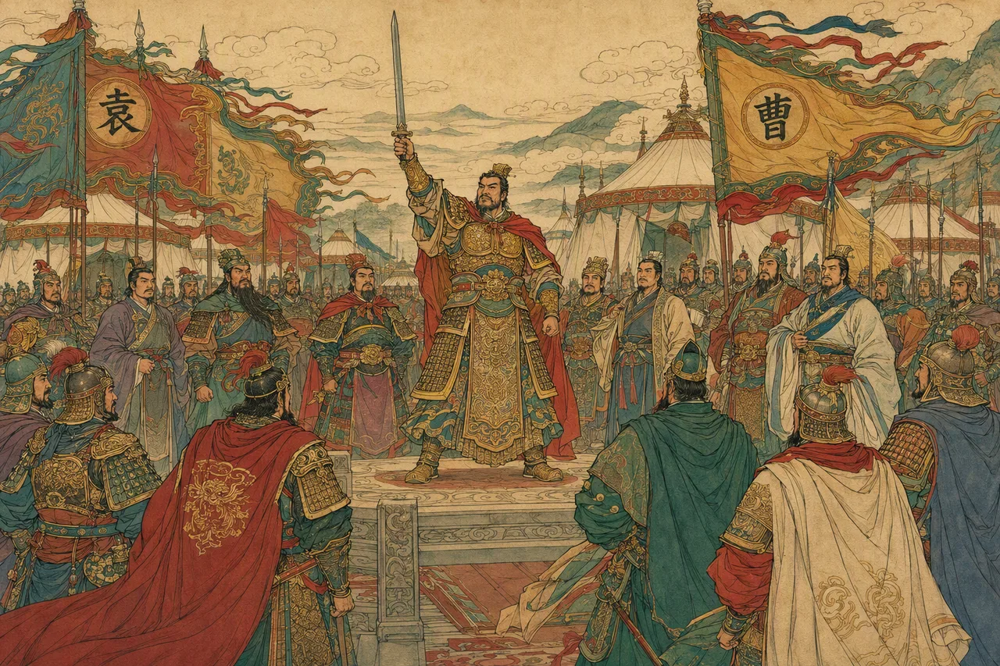

<div align="center">



# 三国藏卷 · 群雄初会

**Collect the Three Kingdoms Cards** — 单文件、移动端优先的三国卡牌收集原型

`可玩原型` · `原生 HTML/CSS/JS` · `零构建` · `localStorage 存档`

[🎮 在线试玩](https://xipho19.github.io/Collect-the-Three-Kingdoms-cards/sanguo-cangjuan-prototype.html) · [玩法说明](#玩法概览) · [本地运行](#本地运行)

</div>

---

## 简介

《三国藏卷 · 群雄初会》是一款以三国为背景的**卡牌收集 + 轻策略布阵**网页原型。全部代码、样式与逻辑都内联在一个 HTML 文件中，打开即玩，无需安装、无需构建。

你可以收集 26 位三国武将和 6 个经典名场面，通过抽卡补全卡册，在「军机台」用前军、中军、谋士三个位置排兵布阵，或带上 6 人小队踏上「九州游历」的回合制分支冒险。

## 快速开始

### 在线试玩

GitHub Pages 已开启，无需安装，直接打开即可游玩：

**https://xipho19.github.io/Collect-the-Three-Kingdoms-cards/sanguo-cangjuan-prototype.html**

> 站点根地址 <https://xipho19.github.io/Collect-the-Three-Kingdoms-cards/> 会由 GitHub Pages 的 Jekyll 将本 README 渲染为首页；游戏本体请使用上面的直达链接。

### 本地运行

推荐用任意静态服务器打开（`file://` 直接双击时，部分浏览器会拦截本地存储或音频）：

```bash
# 在仓库根目录
python -m http.server 8765
# 然后打开 http://localhost:8765/sanguo-cangjuan-prototype.html
```

也可以用 Node：

```bash
npx serve .
```

## 玩法概览

### 1. 抽卡与卡册

- **单抽** 100 铜钱，**十连** 900 铜钱
- 每天 1 次免费卡包，另有 1 次「看广告免费十连」
- 十连的第 10 张保底为**流光**或**炫彩**
- 连续 50 抽未出炫彩时，下一抽必为炫彩（名场面不重置计数）
- 开包结果会汇总新卡、重复卡与残卷收益，可直接「再来一抽 / 再来十连」
- 重复卡自动转化为**残卷**，可在兑换页定向补齐未拥有的卡
- 卡册按势力、稀有度、是否拥有筛选；集齐 8 / 16 / 24 / 32 张可领取阶段奖励

### 2. 军机事件（经典征战）

从已拥有的武将中选择 3 张，分别放入：

| 位置 | 主属性 | 说明 |
| --- | --- | --- |
| 前军 | 武力 | 正面作战，适合高武力武将 |
| 中军 | 忠义 | 稳定军心，适合高忠义武将 |
| 谋士 | 谋略 | 出谋划策，适合高谋略武将 |

系统按事件权重实时计算贡献分，并检查人物羁绊：

- **桃园结义**：刘备 + 关羽 + 张飞，+10
- **魏之奇谋**：曹操 + 郭嘉 + 张辽，+8
- **江东火线**：周瑜 + 黄盖 + 陆逊，+10
- **隆中求贤**：刘备 + 诸葛亮 + 庞统，+8

评分 ≥ 24 视为完成任务，≥ 36 预计大获全胜。当前开放「讨伐黄巾」「桃园结义」「虎牢关前」三个事件。

### 3. 九州游历（Roguelite 分支冒险）

- 编入最多 **6 人小队**，每场战斗**出阵 3 人**（前军 / 中军 / 谋士）
- 每场战斗前选择战术：**猛攻 / 固守 / 奇谋**，影响双方伤害与站位收益
- 编队与战斗界面显示**队伍战力 / 出阵战力**，方便比较阵容
- 6 节点分支路线：战斗、宝藏、营地、精英、Boss
- 生命值跨节点保留，营地可为存活武将恢复 30% 生命
- 偶数回合可让出阵武将施放「奋击」，伤害 ×1.2
- 战败可消耗**续命符**复活（恢复 50% 生命），或观看激励视频复活
- 最终 Boss 张角拥有半血二阶段：受到的伤害 +30%，技能伤害 ×1.25
- 通关结算 100% 奖励，失败或放弃结算 30%

## 卡牌一览

共 32 张：26 位武将 + 6 个名场面。稀有度分为 `普通 / 流光 / 炫彩 / 名场面`。

| 势力 | 武将（稀有度） |
| --- | --- |
| 蜀 | 刘备（流光）· 关羽（炫彩）· 张飞（流光）· 赵云（炫彩）· 诸葛亮（流光）· 马超（流光）· 黄忠（普通）· 庞统（普通） |
| 魏 | 曹操（普通）· 典韦（普通）· 张辽（普通）· 夏侯惇（普通）· 郭嘉（普通）· 司马懿（普通） |
| 吴 | 孙坚（普通）· 周瑜（流光）· 孙权（普通）· 陆逊（普通）· 黄盖（普通）· 吕蒙（普通） |
| 群 | 袁绍（普通）· 董卓（普通）· 张角（普通）· 吕布（炫彩）· 貂蝉（炫彩）· 贾诩（流光） |
| 名场面 | 桃园结义 · 黄巾起义 · 虎牢关前 · 群雄初会 · 赤壁鏖战 · 三顾茅庐 |

> 名场面卡不参与军机布阵，但会计入卡册收集与里程碑。

## 数值速查

| 项目 | 数值 |
| --- | --- |
| 单抽 / 十连 | 100 / 900 铜钱 |
| 抽卡概率 | 普通 70% · 流光 18% · 炫彩 7% · 名场面 5% |
| 十连保底 | 第 10 张必为流光或炫彩 |
| 炫彩保底 | 连续 50 抽内必出（名场面不重置计数） |
| 重复转化 | 普通 30 · 流光 50 · 炫彩 100 · 名场面 100 残卷 |
| 定向兑换 | 普通 100 残卷 · 流光 250 残卷 · 2 残卷 = 1 铜钱 |
| 卡册里程碑 | 8 / 16 / 24 / 32 张 |
| 军机冷却 | 每日前 2 次免冷却，第 3 次起 30 分钟递增，上限 2 小时 |
| 广告跳过冷却 | 每个事件每日 3 次 |
| 游历结算 | 通关 100% · 失败/放弃 30% |

## 项目结构

```
.
├─ sanguo-cangjuan-prototype.html   # 游戏本体：HTML + CSS + JS 全部内联
├─ assets/
│  ├─ cards/                        # 武将立绘、名场面、卡框、背景
│  │  ├─ backgrounds/               # 26 张武将专属背景
│  │  └─ thumbs/                    # 缩略图（代码自动替换路径）
│  ├─ audio/bgm.mp3                 # 背景音乐
│  └─ lamps-*.js                    # Lamps 平台桥接（激励视频等）
└─ README-三国藏卷原型.md            # 早期版本开发记录
```

## 技术实现

- **单文件架构**：所有 UI、样式、数据与逻辑都在 `sanguo-cangjuan-prototype.html` 内，便于分发和离线演示
- **原生技术栈**：无框架、无依赖、无构建步骤
- **存档**：`localStorage['sanguo_cangjuan_save_v1']`，含版本迁移逻辑；支持导出 / 导入 JSON 存档
- **卡面系统**：背景层 → 氛围层 → 人物层 → 卡框 → 特效层；流光 / 炫彩卡带全息扫光动画
- **平台能力**：通过 `assets/lamps-*.js` 接入激励视频（广告十连、跳过冷却、游历复活）；未接入时自动降级为提示
- **适配**：以 375–430px 手机竖屏为主，同时兼容桌面；支持 `prefers-reduced-motion`
- **音频**：背景音乐 + 静音开关，首次进入游戏后播放

## 自定义与扩展

**新增卡牌**：在 HTML 的 `cards` 数组中追加一项即可，无需改动逻辑。

```js
{
  id: 'new_hero',                    // 唯一 id，存档以此为准
  name: '新武将',
  faction: '蜀',                     // 蜀 / 魏 / 吴 / 群 / 名场面
  rarity: 'common',                  // common / rare / holo / scene
  force: 3, strategy: 3, loyalty: 3, // 武力 / 谋略 / 忠义
  specialty: '专长',
  story: '卡牌描述。',
  glyph: '新',                       // 无立绘时的占位字
  c1: '#6e8a63', c2: '#244a3c',      // 渐变配色
  art: 'assets/cards/new-hero.webp', // 立绘（可选）
  bg: 'assets/cards/backgrounds/new-hero-bg.webp' // 背景（可选）
}
```

- 立绘建议使用透明底 webp，提供 1:1 或竖版构图
- 缩略图放在 `assets/cards/thumbs/`，文件名与立绘一致
- 新卡若需参与卡册里程碑，请同步调整 `collectionMilestones`
- 新增人物羁绊在 `relationshipGroups` 中配置

## 已知限制

- 当前为**前端原型**：数值、卡池与活动均为本地配置，没有服务端校验
- 广告相关能力依赖 Lamps 运行时，在普通浏览器中不可用
- 存档保存在浏览器本地，清理站点数据会丢失进度（建议定期导出存档）
- 名场面卡不参与布阵；部分卡面仍使用程序化渐变作为兜底

## 开发记录

早期版本（v0.5）的功能清单与迭代说明见 [README-三国藏卷原型.md](README-三国藏卷原型.md)。当前功能以本 README 为准。

## 说明

仓库暂未附带开源许可证文件；如需复用代码或美术素材，请先确认素材来源与授权。
