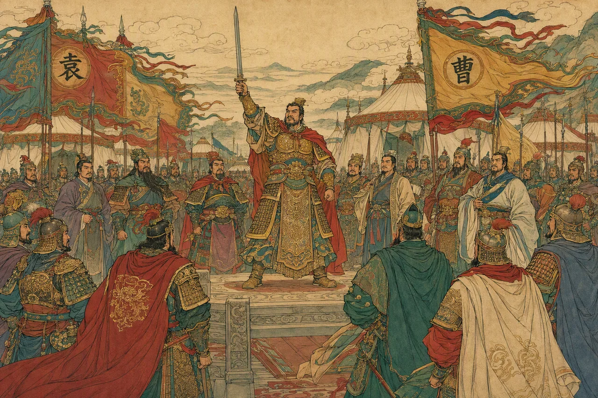

<div align="center">



# 三国藏卷 · 群雄初会

**Collect the Three Kingdoms Cards** — 单文件、移动端优先的三国卡牌收集原型

`可玩原型` · `原生 HTML/CSS/JS` · `零构建` · `本机 + 云存档`

[🎮 在线试玩](https://xipho19.github.io/Collect-the-Three-Kingdoms-cards/sanguo-cangjuan-prototype.html) · [玩法说明](#玩法概览) · [本地运行](#本地运行)

</div>

---

## 简介

《三国藏卷 · 群雄初会》是一款以三国为背景的**卡牌收集 + 轻策略布阵**网页原型。全部代码、样式与逻辑都内联在一个 HTML 文件中，打开即玩，无需安装、无需构建。

你可以收集 32 位三国武将和 6 个经典名场面，通过抽卡补全卡册、升阶强化，在「逐鹿中原」率 3 人小队逐层爬塔，或带上 6 人小队踏上「九州游历」的回合制分支冒险。

## 快速开始

### 在线试玩

GitHub Pages 已开启，无需安装，直接打开即可游玩：

**https://xipho19.github.io/Collect-the-Three-Kingdoms-cards/sanguo-cangjuan-prototype.html**

> 站点根地址 <https://xipho19.github.io/Collect-the-Three-Kingdoms-cards/> 会由 GitHub Pages 的 Jekyll 将本 README 渲染为首页；游戏本体请使用上面的直达链接。

### 本地运行

推荐用任意静态服务器打开（`file://` 直接双击时，部分浏览器会拦截本地存储或音频）：

```bash
# 在仓库根目录
python -m http.server 8765
# 然后打开 http://localhost:8765/sanguo-cangjuan-prototype.html
```

也可以用 Node：

```bash
npx serve .
```

## 玩法概览

### 1. 抽卡与卡册

- **单抽** 100 铜钱，**十连** 900 铜钱
- 每天 1 次免费卡包，另有 1 次「看广告免费十连」
- 十连的第 10 张保底为**流光**或**炫彩**
- 连续 50 抽未出炫彩时，下一抽必为炫彩（名场面不重置计数）
- 开包结果会汇总新卡与重复卡，可直接「再来一抽 / 再来十连」
- 重复卡会**保留在卡册中**，用于武将升阶；残卷可在兑换页定向补齐未拥有的卡
- 卡册按势力、稀有度、是否拥有筛选；集齐 8 / 16 / 24 / 32 / 38 张可领取阶段奖励

### 2. 逐鹿中原（常驻 PVE 爬塔）

- 每层 1 场 **3v3** 战斗，敌方阵容**提前固定**，不随机
- 从已拥有的武将中选择 3 人出阵，可每层更换；每层独立满血开局
- 挑战前可查看敌方阵容、技能、站位与战力，并显示推荐星级
- 系统按 前军 / 中军 / 谋士 的最优位置自动分配站位；开战后自动选择攻击目标
- 开战前选择一次**本层指令**：突击 / 固守 / 用计；之后整层自动战斗
- 每次攻击或受击会显示伤害数字、受击闪烁，生命值逐次扣除
- 胜利晋级下一层并获得铜钱、残卷；失败无惩罚，可调整阵容或升阶后无限重试
- 当前开放 **30 层**：黄巾之乱 1–5、群雄讨董 6–10、江东初定 11–15、官渡争锋 16–20、赤壁鏖战 21–25、汉中决雄 26–30；每 5 层为章节首领战
- 层数越高敌方属性越高，推动玩家抽卡、升阶、凑羁绊

### 3. 九州游历（Roguelite 分支冒险）

- 编入最多 **6 人小队**，每场战斗**出阵 3 人**（前军 / 中军 / 谋士）
- 32 位武将各有独立**技能**，参考三国杀设计：武圣对首领增伤、咆哮追加攻击、刚烈反弹伤害、烈弓优先后排等
- **羁绊不再要求上阵**：只要拥有对应武将即生效；加成为基础值 + 成员平均星级 ×3%（如桃园结义全员 ★1 +5%，全员 ★5 +8%）
- 羁绊效果覆盖攻击力、生命值、暴击率、伤害加成与减伤，多组羁绊可同时生效
- 每回合选择指令：**突击 / 固守 / 用计**，并可点击敌人选择攻击目标
- 战斗界面用敌我立绘替代姓名，攻击、技能、生命、护盾与灼烧状态显示在立绘下方
- 编队与战斗界面显示**队伍战力 / 出阵战力**，方便比较阵容
- 6 节点分支路线：战斗、宝藏、营地、精英、Boss
- 生命值跨节点保留，营地可为存活武将恢复 30% 生命
- 战败可消耗**续命符**复活（恢复 50% 生命），或观看激励视频复活
- 最终 Boss 张角拥有半血二阶段：受到的伤害 +30%，技能伤害 ×1.25
- 通关结算 100% 奖励，失败或放弃结算 30%

### 4. 升阶与每日卡市

- **升阶**：每张卡首次获得时为 **1 星**，每次升阶消耗 **1 张该卡的重复卡**
- 阶位依次为 ★1–★5 → ☾1–☾5 → ☀1–☀5 → ♛1–♛5，**5 冠满阶**，共 20 阶
- **三维为 0–100**：★1 使用卡牌基础值，随阶位成长，5 冠达到潜力上限；逐鹿战力与游历战力同步生效
- 名场面卡也可以升阶，但不参与布阵与战斗
- **每日卡市**：每天刷新 3 张卡（普通 / 流光 / 炫彩或名场面），可用铜钱直接购买
- 已拥有的卡也可以购买，重复卡会保留；每张卡每日限购 1 次

### 5. 排行榜

- 底部导航新增「排行」，包含**中原霸主榜**与**武将典藏榜**两个榜单
- **中原霸主榜**：按已通关的逐鹿中原层数排名，最高 30 层
- **武将典藏榜**：按已拥有卡牌的阶位价值排名，普通每级 20 点、流光每级 50 点、炫彩每级 100 点、名场面每张 80 点
- 已接入 Lamps 平台排行榜：进入榜单页时自动上报最高通关层数与典藏价值，并读取平台前 50 名
- 平台未连接时自动回退为本地演示榜，普通浏览器中不代表全服真实排名

### 6. 云存档

- 在 Lamps 平台内进入游戏时自动读取云存档，读取完成前开始按钮会显示「连接云存档…」
- 首次没有云存档时，会把当前本机进度上传为初始云存档
- 推关、升阶、抽卡、兑换、游历等进度变化后自动同步，约 3 秒合并写入一次
- 云存档包含货币、卡册与阶位、逐鹿关卡、九州游历、抽卡保底、每日进度等必要数据
- 读取失败时可重试，或主动选择「仅使用本机存档」；本机存档作为离线缓存保留
- 云存档按完整快照覆盖，不使用 localStorage 字符串充当云进度

## 卡牌一览

共 38 张：32 位武将 + 6 个名场面。稀有度分为 `普通 / 流光 / 炫彩 / 名场面`。

| 势力 | 武将（稀有度） |
| --- | --- |
| 蜀 | 刘备（流光）· 关羽（炫彩）· 张飞（流光）· 赵云（炫彩）· 诸葛亮（流光）· 马超（流光）· 黄忠（普通）· 庞统（普通） |
| 魏 | 曹操（普通）· 典韦（普通）· 张辽（普通）· 夏侯惇（普通）· 郭嘉（普通）· 司马懿（普通）· 许褚（流光）· 程昱（普通） |
| 吴 | 孙坚（普通）· 周瑜（流光）· 孙权（普通）· 陆逊（普通）· 黄盖（普通）· 吕蒙（普通）· 孙策（炫彩）· 鲁肃（流光） |
| 群 | 袁绍（普通）· 董卓（普通）· 张角（普通）· 吕布（炫彩）· 貂蝉（炫彩）· 贾诩（流光）· 颜良（普通）· 文丑（普通） |
| 名场面 | 桃园结义 · 黄巾起义 · 虎牢关前 · 群雄初会 · 赤壁鏖战 · 三顾茅庐 |

> 名场面卡不参与逐鹿中原与九州游历战斗，但会计入卡册收集与里程碑。

## 数值速查

| 项目 | 数值 |
| --- | --- |
| 单抽 / 十连 | 100 / 900 铜钱 |
| 抽卡概率 | 普通 70% · 流光 18% · 炫彩 7% · 名场面 5% |
| 十连保底 | 第 10 张必为流光或炫彩 |
| 炫彩保底 | 连续 50 抽内必出（名场面不重置计数） |
| 重复卡 | 保留在卡册中，用于升阶 |
| 定向兑换 | 普通 100 残卷 · 流光 250 残卷 · 2 残卷 = 1 铜钱 |
| 卡册里程碑 | 8 / 16 / 24 / 32 / 38 张 |
| 逐鹿中原 | 每层 3v3、敌方固定；胜利晋级，失败可无限重试 |
| 逐鹿奖励 | 每层首通铜钱 + 残卷，层数越高越多；首领层 ×1.5 |
| 逐鹿推荐阶位 | 第 1–4 层 ★1、5–9 层 ★5、10–19 层 ☾4、20–24 层 ☀2、25–29 层 ♛1、第 30 层 ♛5 |
| 羁绊 | 桃园结义 攻击力+5% · 魏之奇谋 暴击率+4% · 江东火线 攻击力+5% · 隆中求贤 生命值+4% · 五虎上将 攻击力+5% · 凤仪亭 伤害加成+5% · 江东基业 攻击力+5% · 江东都督 减伤+4% · 虎卫 减伤+5% · 魏之谋主 伤害加成+4% · 河北双雄 攻击力+5%；拥有即生效，成员平均星级 ×3% 额外加成 |
| 游历结算 | 通关 100% · 失败/放弃 30% |
| 升阶 | 首次 ★1；每次消耗 1 张同卡；★5→☾、☾5→☀、☀5→♛，5 冠满阶（共 20 阶） |
| 三维成长 | 0–100；★1 为基础值，按原成长曲线在 20 个阶位间插值成长到 5 冠潜力上限 |
| 每日卡市 | 每天 3 张，普通 400 / 流光 1000 / 炫彩 2400 / 名场面 1800 铜钱 |
| 中原霸主榜 | 按逐鹿中原已通关层数排名（最高 30 层） |
| 武将典藏榜 | 普通 20 / 级 · 流光 50 / 级 · 炫彩 100 / 级 · 名场面 80 / 张 |

## 项目结构

```
.
├─ sanguo-cangjuan-prototype.html   # 游戏本体：HTML + CSS + JS 全部内联
├─ assets/
│  ├─ cards/                        # 武将立绘、名场面、卡框、背景
│  │  ├─ backgrounds/               # 26 张武将专属背景
│  │  ├─ enemies/                   # 黄巾敌人战斗立绘（张角复用武将卡面）
│  │  └─ thumbs/                    # 缩略图（代码自动替换路径）
│  ├─ audio/bgm.mp3                 # 背景音乐
│  ├─ lamps-*.js                    # Lamps 平台桥接（激励视频等）
│  ├─ game-leaderboard-*.js         # Lamps 平台排行榜桥接与调用入口
│  └─ game-progress-*.js            # Lamps 平台云存档桥接与调用入口
├─ lamps-devtool.html               # 本地 Lamps 平台能力调试宿主页
└─ README-三国藏卷原型.md            # 早期版本开发记录
```

## 技术实现

- **单文件架构**：所有 UI、样式、数据与逻辑都在 `sanguo-cangjuan-prototype.html` 内，便于分发和离线演示
- **原生技术栈**：无框架、无依赖、无构建步骤
- **存档**：`localStorage['sanguo_cangjuan_save_v1']` 作为本机缓存，含版本迁移逻辑；Lamps 平台内通过 `saveGameProgress` / `getGameProgress` 读写云存档，支持导出 / 导入 JSON 存档
- **卡面系统**：背景层 → 氛围层 → 人物层 → 卡框 → 特效层；流光 / 炫彩卡带全息扫光动画
- **技能系统**：32 位武将各有独立技能，逐鹿中原与九州游历的战斗结算中触发增伤、灼烧、反击、击杀成长等效果
- **数值系统**：0–100 三维、20 阶位成长曲线，战力与敌方属性按层数缩放
- **逐鹿中原**：固定楼层配置 + 复用 3v3 战斗结算，按层数动态缩放敌方攻击与生命
- **排行榜**：接入 Lamps 平台排行榜（`submitLeaderboardScore` / `getLeaderboard`）；按 `gameRankType` 分为逐鹿榜与典藏榜，平台不可用时回退本地演示榜
- **平台能力**：通过 `assets/lamps-*.js` 接入激励视频（广告十连、跳过冷却、游历复活）；未接入时自动降级为提示
- **适配**：以 375–430px 手机竖屏为主，同时兼容桌面；支持 `prefers-reduced-motion`
- **音频**：背景音乐 + 静音开关，首次进入游戏后播放

## 自定义与扩展

**新增卡牌**：在 HTML 的 `cards` 数组中追加一项即可，无需改动逻辑。

```js
{
  id: 'new_hero',                    // 唯一 id，存档以此为准
  name: '新武将',
  faction: '蜀',                     // 蜀 / 魏 / 吴 / 群 / 名场面
  rarity: 'common',                  // common / rare / holo / scene
  force: 60, strategy: 65, loyalty: 70, // ★1 基础三维（0–100）
  capForce: 90, capStrategy: 95, capLoyalty: 100, // 5 冠潜力上限
  skill: '技能名',
  skillDesc: '技能效果描述。',
  story: '卡牌描述。',
  glyph: '新',                       // 无立绘时的占位字
  c1: '#6e8a63', c2: '#244a3c',      // 渐变配色
  art: 'assets/cards/new-hero.webp', // 立绘（可选）
  bg: 'assets/cards/backgrounds/new-hero-bg.webp' // 背景（可选）
}
```

- 新增技能需要在 `skillEffects` 中注册对应战斗效果，否则只显示名称与描述
- 立绘建议使用透明底 webp，提供 1:1 或竖版构图
- 缩略图放在 `assets/cards/thumbs/`，文件名与立绘一致
- 新卡若需参与卡册里程碑，请同步调整 `collectionMilestones`
- 新增人物羁绊在 `relationshipGroups` 中配置

## 已知限制

- 当前为**前端原型**：数值、卡池与活动均为本地配置，没有服务端校验
- 广告相关能力依赖 Lamps 运行时，在普通浏览器中不可用
- 存档保存在浏览器本地，清理站点数据会丢失进度（建议定期导出存档）
- 平台排行榜与云存档依赖 Lamps 运行时；普通浏览器中排行榜回退为本地演示榜，存档仅保存在本机
- 云存档每个账号每个游戏只有一条最新进度，读取和保存均为完整快照覆盖
- 名场面卡不参与布阵；部分卡面仍使用程序化渐变作为兜底

## 开发记录

早期版本（v0.5）的功能清单与迭代说明见 [README-三国藏卷原型.md](README-三国藏卷原型.md)。当前功能以本 README 为准。

## 说明

仓库暂未附带开源许可证文件；如需复用代码或美术素材，请先确认素材来源与授权。
